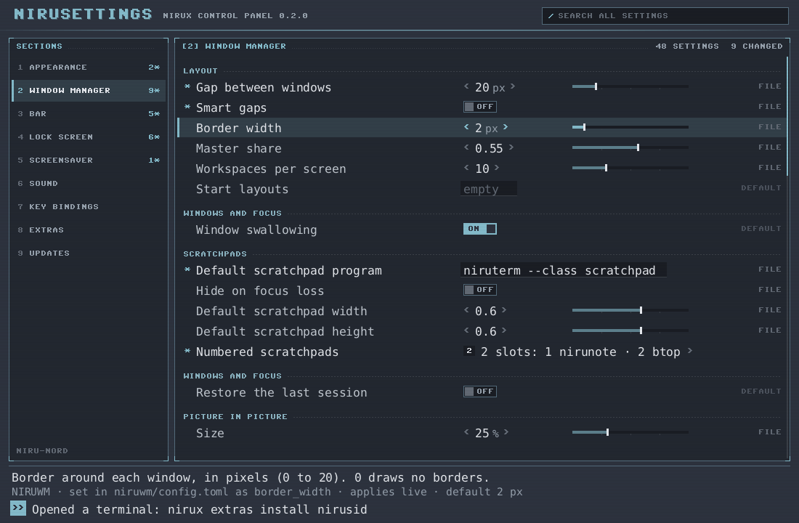

# NIRUSETTINGS

A retro settings app for the NIRUX desktop: one window, a control panel in
the live NIRUX theme colours with pixel-font headings and faint scanlines,
for the theme, the window manager, the bar, the lock screen, the
screensaver, the event sounds, the key bindings, the extras and updates.
Small, fast, keyboard driven, and careful with your files.

**Status: alpha** · Part of the [NIRUX](https://github.com/nirucon/nirux) suite · [MIT License](LICENSE)



More screenshots: [the scratchpad slots](docs/screenshots/scratchpads.png),
[the program picker](docs/screenshots/programs.png),
[a window rule](docs/screenshots/rule.png),
[key bindings](docs/screenshots/keys.png),
[the bar's modules](docs/screenshots/modules.png),
[the lock screen](docs/screenshots/lock.png),
[the theme picker](docs/screenshots/themes.png),
[search](docs/screenshots/search.png), [extras](docs/screenshots/extras.png).
They are taken by the GUI test in a private X server with NIRUX's example
configuration, so no real host data is shown.

## About

The NIRUX programs are configured with TOML files, and those files are
documented well, but a person who wants a wider gap or the bar at the
bottom should not have to read a configuration reference first.
NIRUSETTINGS shows those settings as a list you can change with the arrow
keys, checks every value the way the program itself would, writes only the
line that changed, and tells the program to apply it.

It is **schema driven**: every setting is described in a schema file
(`schema/niruwm.toml`, `schema/nirulock.toml`, ...) with its key, type,
default, allowed values, one line of help and how it is applied. The window
is generated from those files, so a new setting is a schema edit. The
format is in [docs/SCHEMA.md](docs/SCHEMA.md), and other programs (the
launcher) can read the same files.

It is an optional NIRUX extra and draws its own window on X11 with the
toolkit of NIRUSYS (x11rb, its own canvas, MIT-SHM, the 8x8 pixel font from
NIRUSID). It takes about 6 MB of memory, shows its first frame in 15 to
30 ms, and uses no CPU at all while you are not touching it.

## Features

- **273 settings and four lists in six sections**, all from the
  components' own parsers:
  - **Appearance**: the NIRUX theme (a picker with colour swatches, your own
    themes included), font size and file, the wallpaper (on, mode, folder,
    rotation, scaling, follow the theme, art or signature picture), reduced
    motion and the colour overrides of the appearance contract.
  - **Window manager**: gaps, smart gaps, borders, master share, workspaces
    and their start layouts, swallowing, the default scratchpad,
    picture in picture, programs (terminal, browser, launcher), night light
    and brightness step, and three lists: the **scratchpad slots** 1 to 9,
    the **programs at login** (autostart) and the **window rules**.
  - **Bar**: on or off, edge, height, transparency, the modules and their
    order (a list editor: Space switches one, Shift+Up/Down moves it), what
    hides while presenting, workspace labels, window title, clock formats,
    icons, panels, tray, and NIRUBAR's own file: weather place, timer,
    calendar and how long each panel stays open.
  - **Lock screen** (NIRULOCK): layout (demo included), spectrum or quotes,
    password echo, host name, fonts, and the pause music (on, shuffle,
    folder, seconds per tune, which locks play).
  - **Screensaver**: the idle ladder (screensaver after, lock after, display
    off after, programs that keep it awake, lid, proximity lock) and the
    scene, shuffle, photos, layout and behaviour of NIRUSCREENSAVER, with
    a preview of any scene (`p`).
  - **Sound**: the event sounds, volume, robot voice, and each category and
    event.
- **Scratchpads**: the nine slots of Super+Alt+1 to 9, each with its
  program, window class and size, or free for the windows you send there
  with Super+Alt+Shift+N. A program is picked from the installed ones (their
  desktop files, with icons) or typed, and gets the window class NIRUWM
  needs: a program with a class option gets one of its own
  (`niruterm --class scratch-btop -e btop`), any other one runs as
  `sh -c "exec PROGRAM" --class CLASS` with its real class from its desktop
  file or the list of NIRUX programs, and a guess is marked as one.
- **Autostart and window rules**: a list each, an entry at a time in a
  form, from the same program picker. Rule workspaces are shown and typed
  from 1 like everywhere else and written from 0 as NIRUWM reads them.
- **Key bindings**: every binding in effect, grouped and searchable, and
  editable: change the keys, the action (from a list) or the words, add one,
  remove one (a built-in binding is released with `unbind`), or put NIRUWM's
  own back. A key already bound asks before it is replaced, and a binding
  that is the same physical key as another on the current keyboard layout
  (Super+/ and Super+7 on a Swedish keyboard) is marked and explained.
- **Extras**: what is installed, pinned and available (`nirux extras list`);
  Return installs or updates one in a terminal, Delete removes it.
- **Updates**: the installed NIRUX release, the newest one the bar has
  seen, the version of each component, and `nirux update` in a terminal.
- **Search** across every setting and key binding with `/`.
- **Where a value comes from**: `FILE` (set in the file) or `DEFAULT`, a `*`
  for a value that differs from the default, `R` (or `r`) resets it, `u`
  undoes the last change.
- **Safe writes**: see below.
- **Applied live** where the component can do it (`niructl reload` for
  NIRUWM and NIRUBAR, NIRUIDLE and the sounds reread their files); a
  setting that waits for the next lock, start or login says so.
- **One window**: a second start raises the first and opens the section
  it was given (`nirusettings bar`).

## Safe writes

NIRUWM and NIRUBAR refuse a whole configuration file for one unknown key or
one bad value, and NIRULOCK falls back to every default when its file has
an error. So a change goes through three checks before the file is
replaced:

1. The schema: type, range, choices, time and colour formats, list rules,
   and the component version (the `demo` lock layout is refused while
   NIRULOCK 0.29 is installed, because it would refuse the file).
2. The edit: the file is changed with `toml_edit`, so only the key you
   touched changes; comments, order and every other line stay. An alias
   the file already uses (`title` for `show_title`) is edited in place.
3. The components themselves, when installed: `niruwm --check-config` and
   `nirubar --check-config` check the candidate in a temporary copy of the
   configuration folder. If they say no, nothing is written and the window
   shows their message; what they accept but warn about (a rule on the
   wrong workspace) is shown too.

A list (scratchpad slots, autostart, rules, key bindings) is edited one
entry at a time in a form and written as a whole when you save: entries
nobody touched keep their place and comments, a changed one is edited key
by key, and a save NIRUWM refuses brings the form back as it was.

The old file is kept once per session as `FILE.bak`, and the new file is
written to a temporary name, flushed and renamed over the old one, with
its permissions. Every write starts from the file on disk, so a change
NIRUWM made meanwhile (it saves your layouts into its file) is kept. A
change made by another program shows up in the window by itself.

## Requirements

- X11 (any window manager; NIRUWM for the live theme and `niructl reload`)
- To build: Rust 1.85 or newer and a C compiler (`install.sh` installs them
  when missing)
- Optional: `fc-match` (fontconfig) to find the theme font, `niructl`,
  `niruwm`, `nirubar` (live apply and their checks), `nirux` (extras and
  updates)

## Installation

### With NIRUX

```sh
nirux extras install nirusettings
nirux extras update            # later, for the extras you selected
```

NIRUX downloads the pinned source of a NIRUSETTINGS release, verifies it
and runs its `install.sh`, which builds it on the computer.

### Standalone

```sh
git clone https://github.com/nirucon/nirusettings
cd nirusettings
./install.sh                   # asks before installing build packages
./install.sh --yes             # installs them without asking
./install.sh --no-deps         # never installs system packages
```

What `install.sh` does:

1. Installs the missing build packages with the distribution's package
   manager and `sudo` (after asking, or at once with `--yes` or when NIRUX
   sets `NIRUX_ASSUME_YES=1`):

   | Distribution | Packages |
   |---|---|
   | Debian, Ubuntu | `cargo gcc` |
   | Arch | `rust gcc` |
   | Void | `cargo gcc` |

2. Builds with `cargo build --release --locked` and installs
   `~/.local/bin/nirusettings`, the icon,
   `~/.local/share/applications/nirusettings.desktop` (with actions for
   Appearance, Bar, Lock screen and Key bindings) and the schema files in
   `~/.local/share/nirusettings/schema/`.

NIRUSETTINGS never needs root.

## Usage

```sh
nirusettings                   # the window
nirusettings bar               # open at a section: appearance, wm, bar, lock,
                               # screensaver, sound, keys, extras, updates, 1-9
nirusettings --list [SECTION] [--json]   # every setting, value and source
nirusettings --get gap
nirusettings --set bar.position bottom   # the same checks as the window
nirusettings --set nirulock:layout demo  # component:key when a key is in two files
nirusettings --reset gap
nirusettings --get rules       # a list: one inline table per line
nirusettings --add rules class=thunderbird workspace=8 floating=true
nirusettings --add scratchpad.slot number=2 'command=niruterm --class scratch-btop -e btop'
nirusettings --add keys keys=super+z 'action=start nirufm'
nirusettings --remove rules thunderbird    # by id, first field or place
nirusettings --set nirubar:weather.latitude 58.35
nirusettings --schemas         # the schema files in use, and their problems
```

### Keys

| Key | What it does |
|---|---|
| Up, Down, PageUp, PageDown, Home, End | move |
| Left, Right, `+`, `-` | change a number, choice or switch (Shift: ten steps) |
| Space | switch on or off; open a list |
| Return | edit: a text field, the choice picker or the list editor |
| `r`, Delete | reset to the default |
| `u`, Ctrl+Z | undo the last change |
| `/`, Ctrl+F | search every setting and key binding |
| `1` to `9` | open a section |
| Tab, Esc | between the sections and the settings; Esc also closes an editor |
| `p` | preview a screensaver scene; in a form, choose a program |
| `a` | add an entry to a list, or a key binding |
| `?` | the keys, in the status line |
| Ctrl+Q, `q` in the section list | quit |

In a text field: Left, Right, Home, End, Backspace, Delete, Ctrl+U clears,
Return keeps it (or says why not), Esc leaves it as it was. In the module
list: Space switches a module, Shift+Up and Shift+Down move it.

In a list (scratchpad slots, autostart, rules, key bindings): Return opens
an entry, `a` adds one, Delete removes it, Shift+Up and Shift+Down move it
when the order matters, Esc goes back. In its form: Return or Left/Right
change a field, Delete unsets an optional one, `p` opens the program picker
(type to filter), Ctrl+S saves, Esc cancels (and asks when something
changed). In the keys field a combination pressed with Super, Ctrl or Alt is
written for you; key bindings: `r` puts NIRUWM's own binding back.

Mouse: click a section or a setting; click a switch, the arrows of a number
or a choice, or a point on a slider; the wheel over a value changes it;
right click resets; hover shows the help.

## Files and paths

| Path | What |
|---|---|
| `~/.config/niruwm/config.toml` | NIRUWM, NIRUBAR (`[bar]`) and NIRUIDLE (`[idle]`) |
| `~/.config/niruwm/appearance.toml` | the NIRUX appearance contract (colour overrides, reduced motion) |
| `~/.config/nirubar/config.toml` | NIRUBAR's own: `[weather]`, `[timer]`, `[calendar]`, `[popup_timeout]` |
| `~/.config/niruui/lock.toml` | NIRULOCK |
| `~/.config/niruui/screensaver.toml` | NIRUSCREENSAVER |
| `~/.config/nirux/sounds.toml` | the NIRUX event sounds |
| `FILE.bak` | the previous version of a file, once per session |
| `~/.local/share/nirusettings/schema/` | the schema files of the installed version |
| `~/.cache/nirusettings/` | the font found by fc-match |
| `$XDG_DATA_HOME/applications`, `$XDG_DATA_DIRS/applications` | the programs the program picker lists (read only) |

`NIRUSETTINGS_ROOT` points every configuration file at another folder
(tests), `NIRUSETTINGS_SCHEMA_DIR` at other schema files,
`NIRUSETTINGS_NO_APPLY=1` writes without running `niructl reload`.

## How it works

One thread draws, one worker writes, checks and asks the system. The
window sleeps in `poll()` on the X connection, the worker's eventfd and
inotify on the configuration folders; there is no timer at all unless a
change is waiting to be written (changes settle for 350 ms, so a held `+`
is one write) or a text cursor blinks. The picture is drawn in tiles
straight into a MIT-SHM segment. A theme change in NIRUWM recolours the
window at once.

## Performance

Measured by `tests/xvfb.sh` in a private Xvfb (release build):

| | |
|---|---|
| first frame | 12 to 30 ms |
| memory | about 5.9 MB resident (1 MB of it its own heap) |
| CPU while idle | 0.00 % |
| binary | 1.8 MB |

## Testing

```sh
cargo test                     # schemas, checks, edits, the examples
sh tests/xvfb.sh target/release/nirusettings
sh tests/components.sh target/release/nirusettings DIR   # DIR: built niruwm and nirubar
```

`tests/schemas.rs` checks every schema key against the components' example
configurations, the list fields against NIRUWM's structs and actions, and
NIRUBAR's own file against the bar's source. `tests/xvfb.sh` drives the
window in a private X server with HOME and every XDG folder in a temporary
directory, including the scratchpad, autostart, rule and key binding
editors and the program picker. `tests/components.sh`
writes every default, every choice and both ends of every range of the
shared NIRUWM file and has the real NIRUWM and NIRUBAR check each result
(200 values, all accepted, for NIRUWM 0.37.15 and NIRUBAR 0.34.2).

## Uninstall

```sh
./uninstall.sh                 # the program, desktop entry, icon, schema files
./uninstall.sh --purge         # also its cache and state
```

Your settings files belong to the other programs and are never removed.

## Status, disclaimer and how it's made

**Status: alpha.** It runs on my machines and passes its tests; the look
and the list of settings will still change.

NIRUX and every niru* project are made by me, Nicklas Rudolfsson
([@nirucon](https://github.com/nirucon)), for me. They are tailored to my own
needs, preferences and workflows, on my own machines. If they fit yours too,
that's a nice bonus.

- **Free and open source.** Anyone is free to use, study, change and share
  it under the [MIT License](LICENSE).
- **No guarantees.** There is no warranty of any kind. Use it at your own
  risk, read what you install and keep backups of anything that matters.
- **How it's made.** Some of these projects I built from scratch by hand. In
  more recent releases I have used Claude, Anthropic's AI, to do much of the
  heavy lifting under my direction: I decide what to build and how it should
  behave, and I test it on my own machines. It saves me a lot of time, and
  the result is quite OK.
- **Alpha, beta, dev, and maybe forever.** Most things here are alpha, beta
  or dev, and may stay that way. Maybe one day there will be a real stable
  release, but given how fast development moves, and how I am as a person,
  maybe never :)

| Label | Meaning |
|---|---|
| dev | Under active construction; may not build, install or work yet. |
| alpha | Works on my machines, but incomplete or rough; expect breaking changes. |
| beta | In daily use on my machines and mostly complete; rough edges remain. |

## License

MIT License, see [LICENSE](LICENSE). Copyright (c) 2026 Nicklas Rudolfsson.

The pixel font comes from NIRUSID and the window toolkit from NIRUSYS, both
made for NIRUX. The icon is made for NIRUSETTINGS.
